<div align="center">

# lieflat code video

**用代码，拍一部产品发布片。**

基于 Remotion + React 的 Claude Code 技能，把镜头运动、产品操作和节奏组织成一部完整的片子。

**简体中文** · [English](README.md)

**64 个动态示例 · 8 组镜头语言**

</div>

**官网与商业授权：** [lieflat.work · Lieflat Code Video](https://lieflat.work/skills/code-video/)

[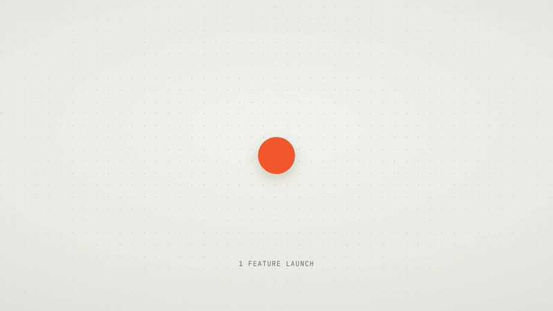](assets/showreel.mp4)

**[▶ 观看完整作品合集 · 约 55 秒，含声音](assets/showreel.mp4)**

四个产品，四种视觉表达。上方 GIF 为完整视频的片段节选。

## 先看镜头怎么动，再决定怎么拍

Lens 收录了 **64 个动态示例，分成 8 组镜头语言**。推近、跟拍、变形、卡拍、文字动画……先看到效果，再用具体的编号描述你想要的镜头。

### 01 — 镜头运动

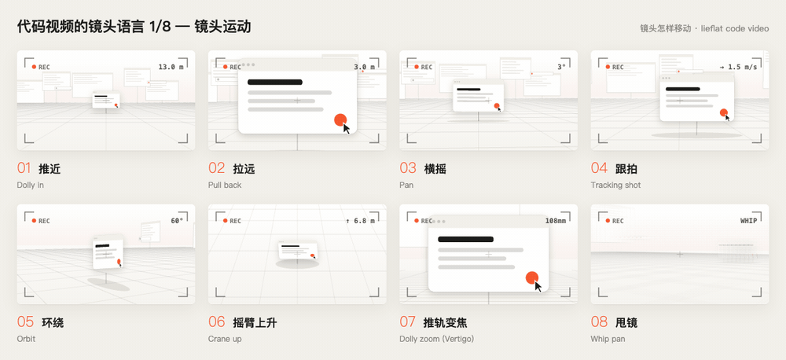

### 02 — 转场与递接

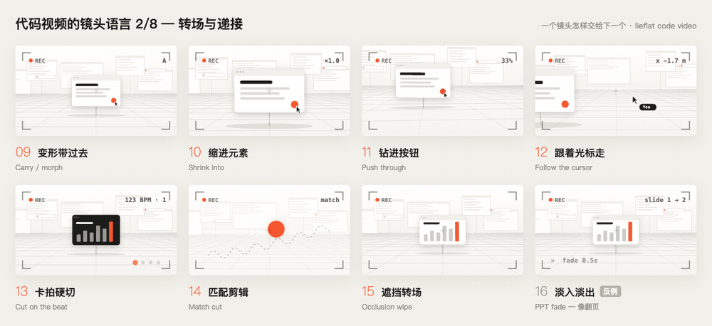

<details>
<summary><strong>展开另外 48 个动态示例 →</strong></summary>

### 03 — 镜头与转场（续）· 17–24

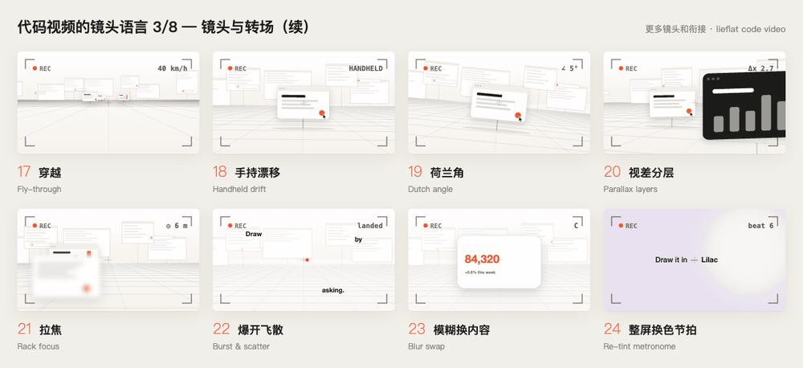

### 04 — 物理与节奏 · 25–32

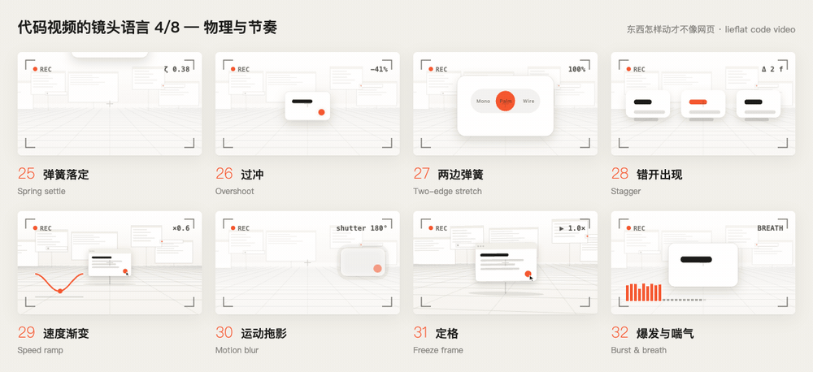

### 05 — 界面展示 · 33–40

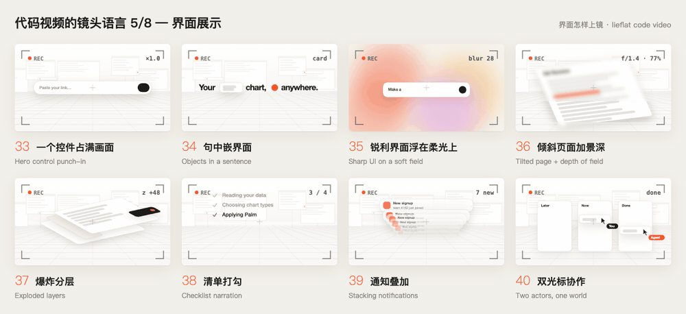

### 06 — 文字与主张 · 41–48

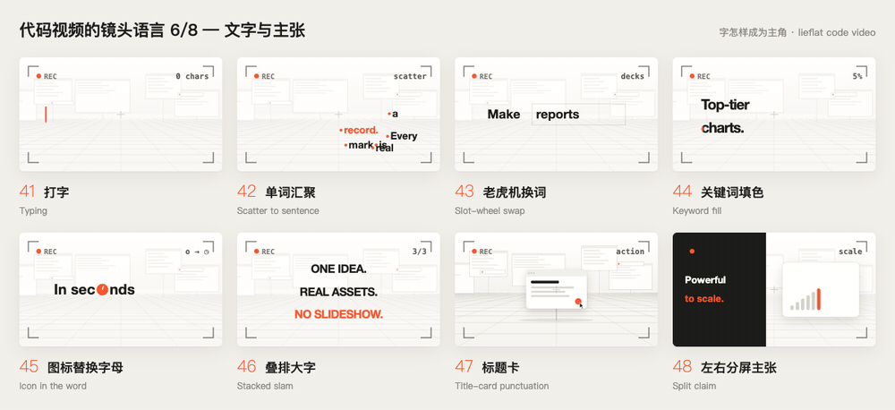

### 07 — 证明与数据 · 49–56

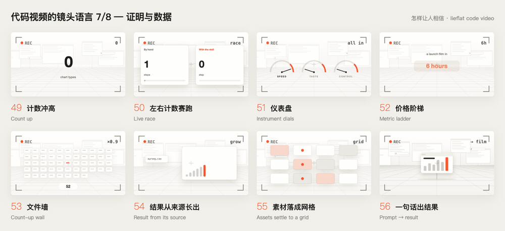

### 08 — 节奏、界面与收尾 · 57–64

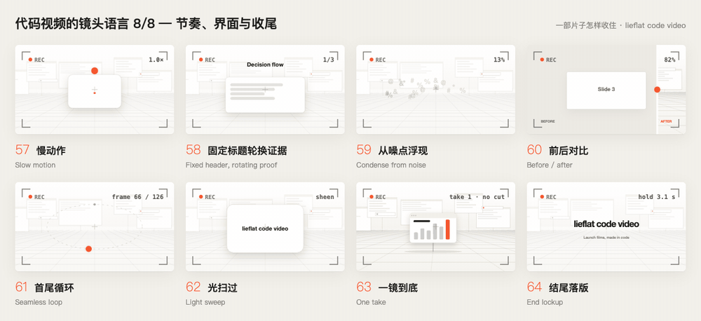

</details>

**[查看 Lens 页面文件](lens/index.html)**：下载本仓库后，用浏览器打开 `lens/index.html` 即可播放全部 8 页，无需安装依赖或构建。GitHub 中的链接会显示 HTML 源码，下载后的文件可直接运行。

你可以这样描述分镜：“开场用 **09 变形带过去**，展示结果时用 **13 卡拍硬切**，最后接 **64 结尾落版**。”

这 64 个条目是镜头参考，不等于 64 套完整视频模板。其中 **16** 是淡入淡出的反例，**32** 是节奏原则，**15 / 37** 是尚无现成制作组件的概念示意。Lens 中都可以观看；完整制作工具包为其余 60 个条目提供了实现映射。

## 同一套工作流，拍出不同的产品气质

<table>
<tr>
<td width="50%">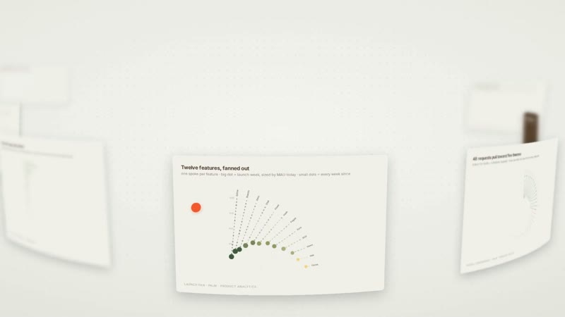<br><strong>Lieflat Charts</strong><br>环绕卡片、数据展示与主题切换。</td>
<td width="50%">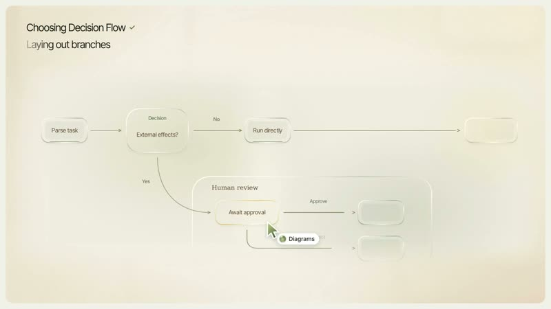<br><strong>Lieflat Diagrams</strong><br>从一句指令，到图示生成与结构变化。</td>
</tr>
<tr>
<td width="50%">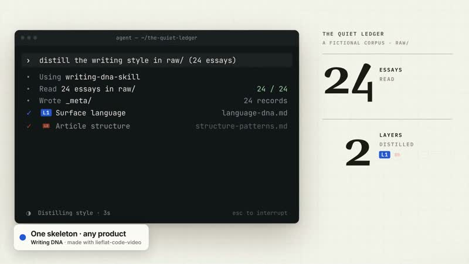<br><strong>Writing DNA</strong><br>把编辑式排版与实际操作界面接在一起。</td>
<td width="50%">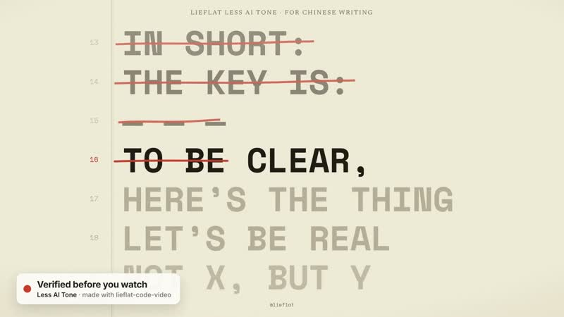<br><strong>Less AI Tone</strong><br>让文字本身成为动作：删去、替换、重写。</td>
</tr>
</table>

这四个案例均出现在[完整作品合集](assets/showreel.mp4)中。它们用于展示制作流程的效果；本仓库另附一套可运行的起步工程；这四部案例的完整工程暂不包含。

## 一部片子是怎样组织起来的

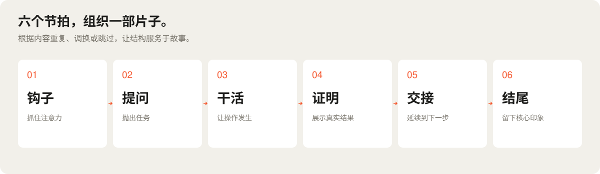

先列出观众必须看懂的内容，再给每一点安排一个插槽。插槽里可以放产品操作，也可以放一个动作；镜头和节奏负责把它们连起来。

| 层次 | 负责什么 |
| --- | --- |
| 叙事 | 钩子、提问、干活、证明、交接、结尾。角色可以重复，也可以调换顺序。 |
| 产品 | 用产品自己的界面、内容和操作，讲清它独有的价值。 |
| 动作 | 用共同物体、镜头运动、光标行为和转场，连接前后场景。 |
| 节奏 | 按节拍安排时长，交替使用快慢段落，给结尾留出读完的时间。 |

完整制作流程是 **内容大纲 → 分镜 → 配置 → 预览 → 检查 → 渲染 → 声音**。一个影片配置文件协调插槽、镜头与光标；结构检查和成片检查帮助发现内容遗漏、空白帧、冻结及节奏问题。

## 从一条能跑起来的片子开始

仓库包含一个**可以预览、修改并导出视频的起步工程**。内置虚构产品 Acme Notes 的 12 秒示例，镜头运动、输入交互、卡片变形、词语转轮和结尾落版都可以直接查看与修改源码。

[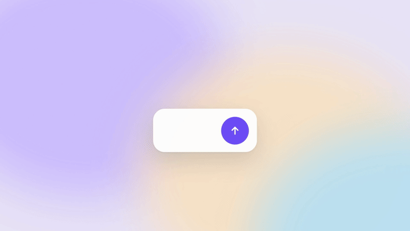](assets/starter-example.mp4)

**[▶ 观看起步工程实际导出的示例 · 12 秒，无声](assets/starter-example.mp4)**

### 快速开始

安装 Node.js 22 或更新版本，下载仓库后，在仓库根目录执行：

```bash
cd starter
npm ci
npm run check
npm run studio
```

打开终端显示的本地地址预览。在 `starter` 目录另开终端，导出正式视频：

```bash
npm run render
```

输出为 `starter/out/film.mp4`：**1080p、30 fps、H.264，开启运动模糊**。快速检查可用 `npm run preview`，生成半尺寸预览；完整操作见[起步工程说明](starter/README.md)。

### 可以改什么

| 你想做的事 | 从这里开始 |
| --- | --- |
| 换产品名、文案、配色 | `starter/src/content.ts` |
| 调整节拍与镜头时长 | `starter/src/film.ts` |
| 换成自己的产品界面 | `starter/src/Video.tsx` |
| 增加镜头、文字或弹簧动画 | `starter/src/kit/` |
| 让代码助手协助制作 | 阅读仓库中的 [SKILL.md](SKILL.md) |

示例默认无声。可添加自己有权使用的音乐；制作中文影片时还需配置中文字体。时间线检查不能替代看片，替换内容后请检查文字是否可读、镜头衔接是否自然。声音、分镜和产品素材仍然决定最终完成度。

### 公开内容

```text
SKILL.md               面向代码助手的起步制作指南
starter/               可运行的 Remotion 工程与 Acme Notes 示例
  src/content.ts       产品内容和配色
  src/film.ts          时间线、节拍和事件
  src/kit/             镜头、弹簧、转场、文字与界面组件
lens/index.html        64 个动态镜头参考
assets/                作品合集、起步示例与 README 配图
LICENSE.md             项目代码许可
USAGE.md               使用范围与商业授权
```

这个版本公开了独立完成起步示例所需的代码。完整案例工程、完整动作与片段库、自动抓取、成片自动验收和高级混音流程暂不包含；你可以在现有工程上继续编写自己的场景。上方作品合集展示的是完整制作流程的成果，不能只改产品名就原样复现。

## 非商业使用与商业授权

Lens 演示代码、起步工程及制作指南采用 **[PolyForm Noncommercial License 1.0.0](LICENSE.md)**。欢迎个人学习、实验，以及许可允许的其他非商业用途。超出该许可范围的商业使用，需要另行取得书面授权；购买方式见下方官网链接。

视频和图片用于观看与参考；软件许可不授予其中音乐、字体、产品品牌及其他第三方素材的复用权。具体范围见[使用与授权说明](USAGE.md)。

如需用于商业宣传片、客户项目，或集成到收费产品与服务中，请[前往 lieflat.work 选择并购买适用授权](https://lieflat.work/skills/code-video/#pricing)。超出网站列明授权范围的需求，可联系 **[larashero3@gmail.com](mailto:larashero3@gmail.com)**。

因此，本项目使用“**非商业公开版 / 部分源码可见**”的表述。[OSI 开源定义](https://opensource.org/osd)要求允许商业使用，和本项目的授权目标不同。
